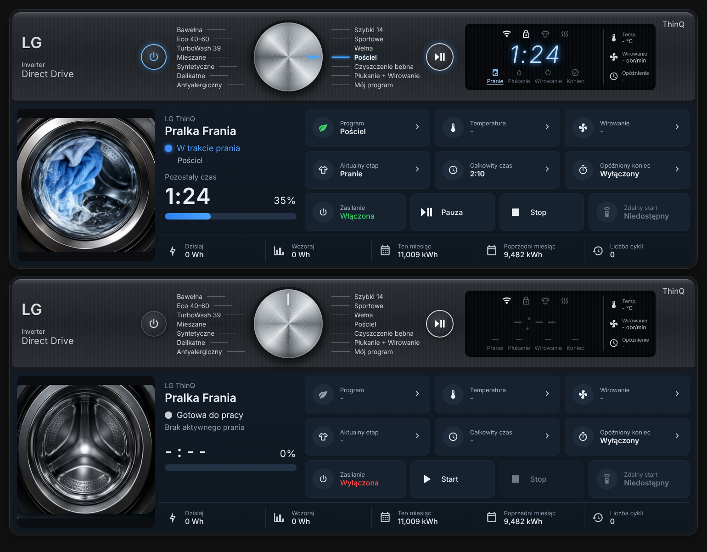

# LG ThinQ Washer Card

Kafelek Lovelace dla pralek LG podpiętych przez oficjalną integrację **LG ThinQ** (`lg_thinq`) w Home Assistant.
Wygląda jak panel pralki: gałka z programami, wyświetlacz z czasem i etapem, animowany bęben, sterowanie i zużycie energii.



## Instalacja (HACS)

1. HACS → menu ⋮ → **Custom repositories** → wklej URL tego repo, kategoria **Dashboard**.
2. Wyszukaj **LG ThinQ Washer Card** → Download.
3. Odśwież przeglądarkę (Ctrl+F5).

Ręcznie: wrzuć `dist/lg-thinq-washer-card.js` do `/config/www/` i dodaj zasób
`/local/lg-thinq-washer-card.js` (typ: JavaScript module).

## Minimalna konfiguracja

> Typ karty to `custom:lg-thinq-washer-panel-card` (inna nazwa niż w paczce *HomeAssistantLGThinkQCards*, żeby się nie gryzły).

```yaml
type: custom:lg-thinq-washer-panel-card
prefix: frania
name: Pralka Frania
```

`prefix` to część nazwy encji, np. `frania` dla `sensor.frania_current_status`.
Na tej podstawie karta sama znajdzie encje:

| Klucz | Domyślna encja |
|---|---|
| power | `switch.<prefix>_power` |
| operation | `select.<prefix>_operation` |
| status | `sensor.<prefix>_current_status` |
| remaining_time | `sensor.<prefix>_remaining_time` |
| total_time | `sensor.<prefix>_total_time` |
| delayed_end | `number.<prefix>_delayed_end` |
| delayed_end_time | `sensor.<prefix>_delayed_end` |
| remote_start | `binary_sensor.<prefix>_remote_start` |
| cycles | `sensor.<prefix>_cycles` |
| energy_today / energy_yesterday / energy_this_month / energy_last_month | `sensor.<prefix>_energy_*` |
| error / notification | `event.<prefix>_error` / `event.<prefix>_notification` |
| program, temperature, spin | brak (opcjonalne, patrz niżej) |

Każdą encję można nadpisać w sekcji `entities:`.

## Gałka i program

Oficjalna integracja `lg_thinq` **nie wystawia** aktualnego programu, temperatury ani obrotów dla pralek
(tylko zmywarka ma sensor programu). Dlatego gałka obraca się i podświetla program,
jeśli podasz encję z programem:

```yaml
type: custom:lg-thinq-washer-panel-card
prefix: frania
name: Pralka Frania
entities:
  program: input_select.frania_program    # albo sensor z innej integracji
  temperature: sensor.frania_temperatura  # opcjonalnie
  spin: sensor.frania_wirowanie           # opcjonalnie
program_map:            # gdy encja zwraca inne nazwy niż na panelu
  COTTON: Bawełna
  BEDDING: Pościel
```

- Jeśli `program` to `input_select` / `select` — **kliknięcie nazwy programu na panelu** ustawia go, a gałka się przekręca.
- Opcje `input_select` powinny mieć te same nazwy co lista `programs` (albo użyj `program_map`).
- Własną listę programów (14 pozycji, pierwsza połowa po lewej) podasz w `programs:`.

Przykładowy helper:

```yaml
input_select:
  frania_program:
    name: Frania program
    options: [Bawełna, Eco 40-60, TurboWash 39, Mieszane, Syntetyczne, Delikatne, Antyalergiczny,
              Szybki 14, Sportowe, Wełna, Pościel, Czyszczenie bębna, Płukanie + Wirowanie, Mój program]
```

## Wszystkie opcje

| Opcja | Domyślnie | Opis |
|---|---|---|
| `prefix` | – | prefix encji |
| `name` | `Pralka` | nazwa |
| `subtitle` | `LG ThinQ` | podtytuł |
| `show_panel` | `true` | górny panel z gałką i wyświetlaczem |
| `show_energy` | `true` | pasek energii |
| `confirm_stop` | `true` | pytanie przed Stop |
| `start_option` | `start` | opcja `select.*_operation` dla Start |
| `pause_option` | `stop` | opcja dla Pauzy (w API LG „stop” = pauza) |
| `stop_option` | `power_off` | opcja dla Stop |
| `programs` | lista 14 programów | nazwy na panelu |
| `program_map` | `{}` | mapowanie stanu encji → nazwa programu |
| `drum_style` | `photo` | `photo` = wbudowane zdjęcia bębna (wnętrze kręci się podczas prania), `svg` = rysowana grafika |
| `image_active` / `image_idle` | – | własne zdjęcie bębna (np. `/local/pralka_pranie.png`) zamiast wbudowanego |

## Uwagi

- Start zdalny działa tylko gdy `binary_sensor.<prefix>_remote_start` = `on` (włącza się na pralce przyciskiem Remote Start).
- Kliknięcie kafelków otwiera okno szczegółów danej encji.
- Karta jest responsywna (container queries) — działa w sekcjach, kolumnach i na telefonie.

## Licencja

MIT
